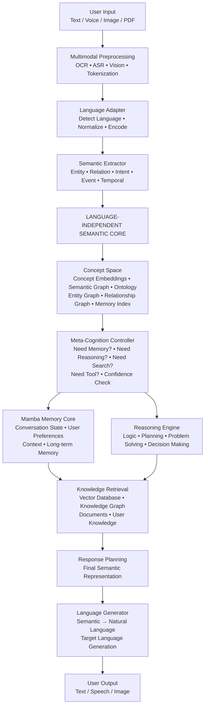
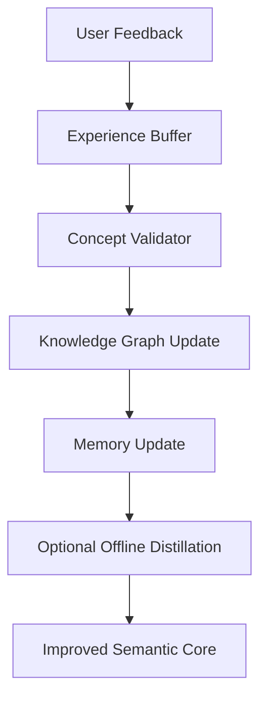
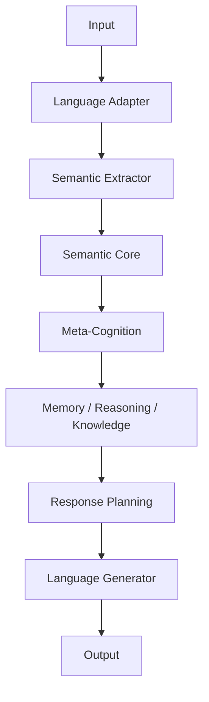

# ECOS v1.0 Architecture

## Main Pipeline

## Background Continuous Learning Loop

## Module Architecture

| Module             | Architecture                         |
| ------------------ | ------------------------------------ |
| Language Adapter   | Small Transformer                    |
| Semantic Extractor | Distilled Transformer                |
| Semantic Core      | Vectors + Knowledge Graph + Ontology |
| Meta-Cognition     | Small Policy Network                 |
| Memory             | Mamba                                |
| Reasoning          | Neural + Symbolic                    |
| Knowledge          | Vector DB + Graph DB                 |
| Language Generator | Small Transformer Decoder            |

## Data Flow

## Key Design Idea

The most important design decision is that everything inside ECOS operates on semantics, not language.

- The Language Adapter converts language → semantics.
- The Semantic Core stores concepts and relationships.
- The Reasoning Engine manipulates concepts.
- The Memory stores conceptual state.
- The Language Generator converts semantics → any language.

This means adding a new language only requires a new Language Adapter and Language Generator. The Semantic Core, Memory, Meta-Cognition, and Reasoning Engine remain unchanged, making ECOS naturally scalable and suitable for multilingual operation on resource-constrained devices.