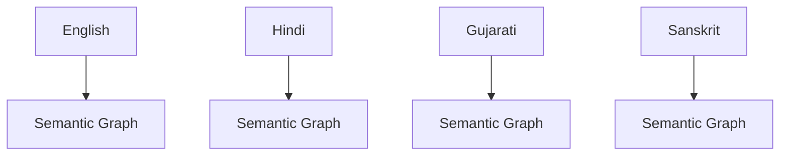
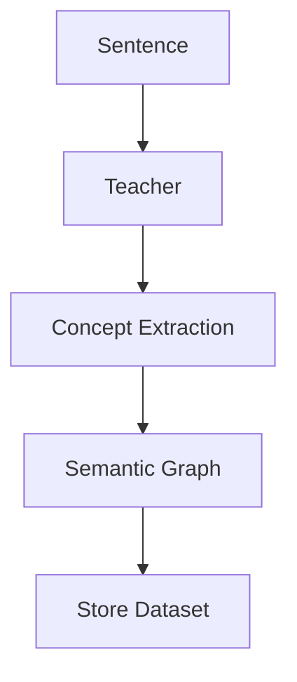
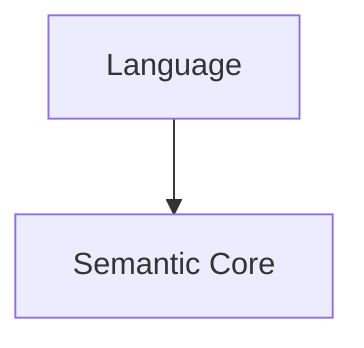
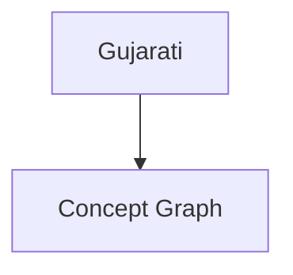
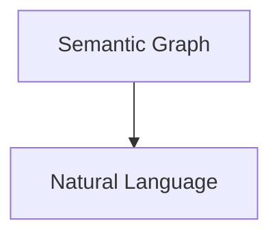
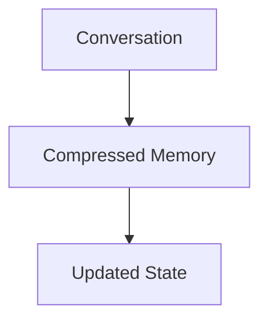
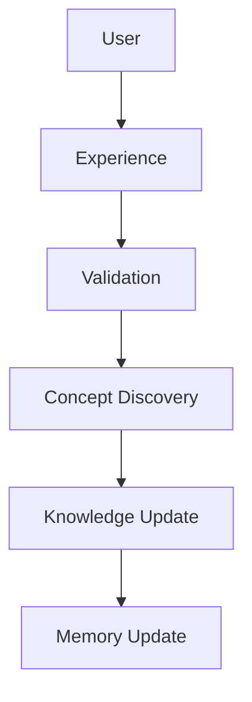
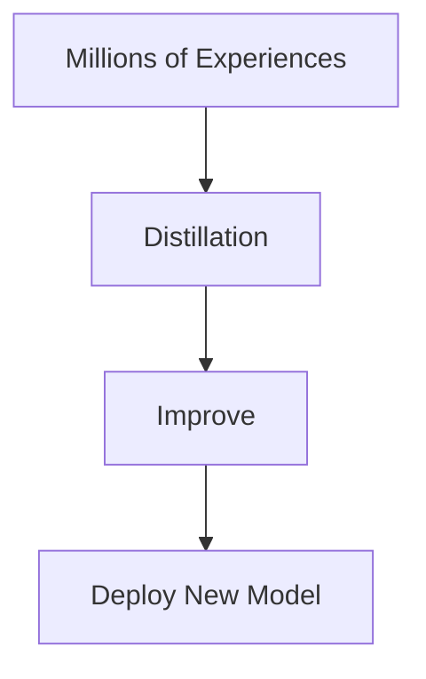
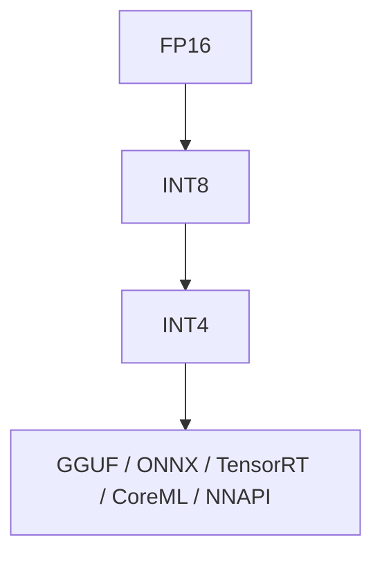
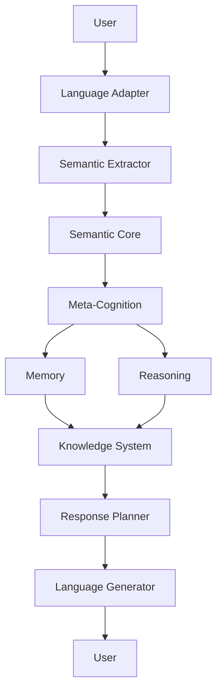

# ECOS Development Phases

## Phase 0 — Research & Design (1–2 Months)

### Goal

Finalize the architecture.

### Deliverables

- ECOS architecture
- Semantic representation design
- Ontology design
- Memory design
- Dataset specification

### Output

- ECOS Architecture Document
- Semantic Specification
- Research Blueprint

## Phase 1 — Build the Semantic Language (2–3 Months)

### Goal

Design the internal language of ECOS.

Instead of text:

> "The cat drinks water."

Convert into:

| Field       | Value    |
| ----------- | -------- |
| Agent       | Cat      |
| Action     | Drink    |
| Object     | Water    |
| Time       | Present  |
| Confidence | 0.98     |

This becomes your Concept Graph.

### Tasks

- Concept ontology
- Entity schema
- Event schema
- Relationship schema
- Temporal schema
- Intent schema

No AI training yet.

## Phase 2 — Dataset Creation (2–4 Months)

### Goal

Now create datasets.

### Pipeline

Build millions of examples.

### Sources

- Wikipedia
- Common Crawl
- OSCAR
- mC4
- Wikidata
- OpenSubtitles
- Books

## Phase 3 — Teacher Distillation (3–6 Months)

### Teacher Models

- Qwen
- DeepSeek
- Llama
- Gemma

### Pipeline

You are not copying logits.

You are building a huge semantic dataset.

## Phase 4 — Train Language Adapter (2–3 Months)

### Train

### Example

This model only learns:

- syntax
- grammar
- parsing

NOT reasoning.

## Phase 5 — Build Semantic Core (2 Months)

### Implement

- Concept Embeddings
- Knowledge Graph
- Ontology
- Memory Index

No neural training.

Just data structures.

### Technologies

- FAISS
- Neo4j
- RDF
- NetworkX

## Phase 6 — Train Generator (2–3 Months)

### Reverse Process

Now ECOS can speak.

## Phase 7 — Mamba Memory (2 Months)

### Train

### Responsibilities

- context
- user memory
- personalization

## Phase 8 — Meta-Cognition (Research Phase)

This is your biggest contribution.

### Input

- Semantic Graph

### Output

- Need Memory?
- Need Reasoning?
- Need Search?
- Need Tool?
- Need Clarification?

This becomes the ECOS controller.

## Phase 9 — Reasoning Engine (3–4 Months)

### Train

Now train reasoning.

### Tasks

- logic
- planning
- mathematics
- chain reasoning
- symbolic reasoning

### Notice

Reasoning never touches language.

It only sees:

- Concept Graph

## Phase 10 — Knowledge System (1 Month)

### Build

- Vector Database
- Knowledge Graph
- Documents
- Memory

Now ECOS has persistent knowledge.

## Phase 11 — Learning Loop (2 Months)

### Implement

No retraining yet.

## Phase 12 — Self Evolution (1 Month)

### Offline

Never let the phone retrain itself continuously.

## Phase 13 — Mobile Optimization (1 Month)

### Convert

### Target

| Metric  | Value                              |
| ------- | ---------------------------------- |
| RAM     | < 5 GB                             |
| Model   | ≈ 2 GB                             |
| Latency | < 500 ms                           |

## Final Architecture

## Recommended Build Order

After following your idea through all these discussions, I think ECOS should not start by training a language model from scratch.

Instead, I would build it in this order:

1. Semantic Representation (the "brain's language")
2. Semantic Dataset
3. Language Adapters
4. Semantic Core
5. Memory (Mamba)
6. Meta-Cognition
7. Reasoning Engine
8. Language Generator

This order minimizes wasted training, keeps the architecture modular, and makes it much easier to add new languages or capabilities later. It also aligns with your long-term vision of ECOS as a language-independent cognitive system rather than another conventional LLM.