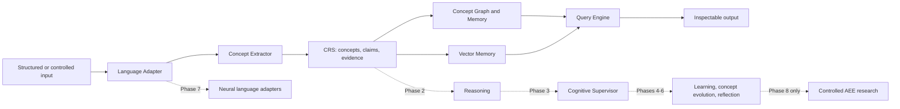

# ECOS Project Overview

**Project:** ECOS — Evolutionary Conceptual Operating System  
**Document version:** 0.1.0  
**Status:** Proposed architecture; no ECOS implementation verified  
**Purpose:** Explain the project’s research bet, system boundary, and practical starting point.  
**Last reviewed:** 2026-11-20

## Vision

ECOS investigates whether structured conceptual representations can provide a durable substrate for reasoning, evidence evaluation, learning, reflection, and controlled concept evolution without making natural language the internal representation. Natural language is an adapter concern; concepts, claims, relationships, and evidence are the core records.

This is a research hypothesis, not an established advantage over language models. The project must test what is gained in inspectability, temporal fidelity, contradiction handling, and cross-lingual reuse—and what is lost in extraction ambiguity, ontology labor, and reasoning coverage.

## Architecture at a glance

## Eight-phase direction

1. **Foundation:** represent and retrieve structured conceptual knowledge without neural networks.
2. **Reasoning:** add explicit logical, mathematical, temporal, spatial, causal, analogical, and commonsense methods.
3. **Cognitive Supervisor:** assess confidence, contradictions, missing knowledge, alternatives, evidence, and verification.
4. **Learning Engine:** integrate evidence and updates while preserving provenance.
5. **Concept Evolution Engine:** introduce, merge, split, refine, and deprecate concepts with lineage.
6. **Reflection Engine:** select contexts and frameworks and compare interpretations.
7. **Neural Language Adapters:** improve translation to and from CRS while preserving the substrate’s independence.
8. **Architecture Evolution Engine:** investigate controlled improvement only after earlier capabilities mature.

**Capability must precede autonomy.** AEE is not part of the initial implementation.

## Initial deliverable

The first engineering target is deliberately small: a local CRS prototype that ingests validated structured claims, stores them durably with evidence, preserves incompatible claims, answers exact and bounded graph queries, and returns inspectable JSON. It does not attempt open-ended language understanding, automated reasoning, continual learning, or self-modification.

See [prototype requirements](../06_implementation/prototype_requirements.md) and [success criteria](../06_implementation/implementation_roadmap.md#prototype-success-criteria).

## Current evidence state

The repository audit found proposals but no ECOS code or executed cognitive experiments. Conceptual examples and external project results are not ECOS validation. The authoritative status record is [Project status](../project_status.md).

## References

- [Problem statement](problem_statement.md)
- [Research objectives](research_objectives.md)
- [Project scope](project_scope.md)
- [Complete architecture](../02_architecture/complete_architecture.md)
