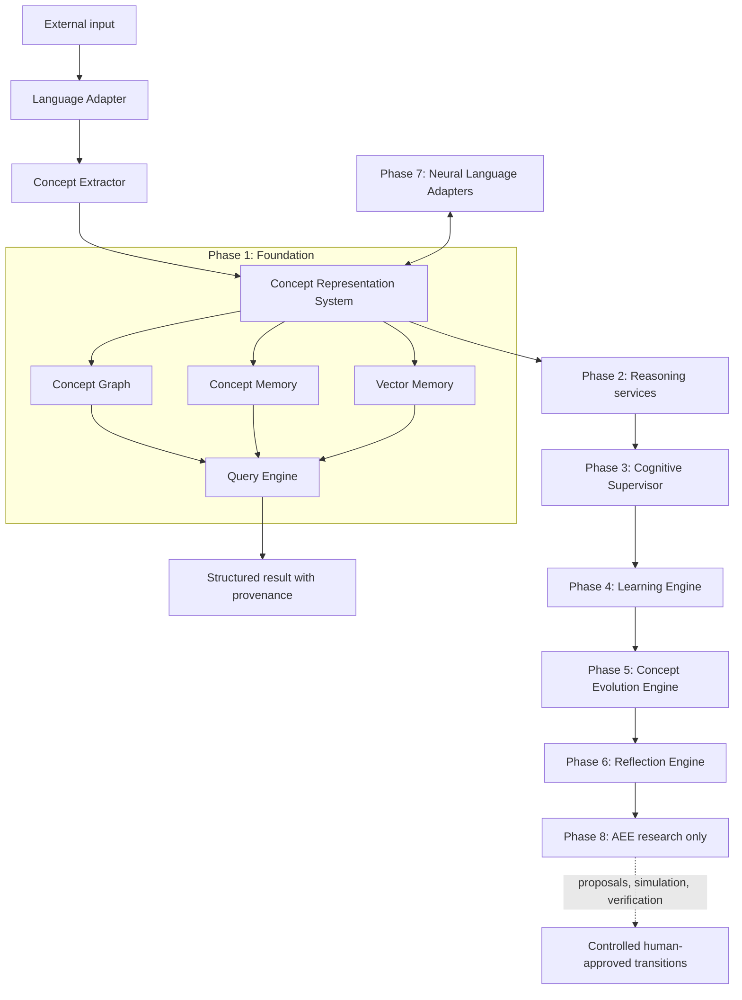

# ECOS Complete Architecture

**Project:** ECOS — Evolutionary Conceptual Operating System  
**Document version:** 0.1.0  
**Status:** Proposed end-state architecture; all ECOS components unimplemented  
**Purpose:** Show component boundaries, dependencies, and the staged path from CRS to controlled architectural research.  
**Last reviewed:** 2026-11-20

## System context

The arrows denote design dependencies, not deployed data flow. The prototype stops at structured query output.

## Layers

| Layer | Responsibility | Must not do |
|---|---|---|
| Adapter | Convert controlled external input/output to CRS exchange records | Hide extraction uncertainty or own canonical meaning |
| Extraction | Validate and map adapter output into candidate concepts and claims | Present unrestricted NLP as solved |
| CRS | Preserve identities, claims, evidence, contexts, provenance, temporal metadata, and vectors | Infer truth from storage or similarity |
| Memory | Provide durable symbolic records and reproducible vector retrieval | Require neural embeddings in Phase 1 |
| Query | Execute exact lookup, filters, bounded traversal, evidence lookup, and similarity | Claim that retrieval equals reasoning |
| Reasoning | Apply explicit rules and return derivations | Use undocumented language-model intuition as proof |
| Supervisor | Evaluate evidence, contradictions, missing knowledge, alternatives, and verification | Manufacture calibrated confidence |
| Learning | Add evidence and update records without erasing history | Overwrite incompatible claims silently |
| Concept evolution | Perform audited concept operations with lineage | Make historical references ambiguous |
| Reflection | Compare interpretations under explicit contexts/frameworks | Treat framework choice as objective truth |
| Neural adapters | Improve language translation while retaining CRS contracts | Change the core’s semantics implicitly |
| AEE | Propose and evaluate architectural changes under control | Modify a running architecture autonomously |

## Canonical records and derived views

The canonical Phase 1 records are concepts, claims, evidence items, contexts, provenance events, and vector records. The Concept Graph is a derived adjacency view over claims. Search indexes and vector indexes are reproducible projections, not independent sources of truth. This avoids splitting epistemic history across incompatible stores.

## Control flow

1. Validate input and adapter metadata.
2. Resolve or create stable concept identities through an explicit, reviewable mapping.
3. Append claims and evidence in one transaction.
4. Build or refresh graph and vector projections.
5. Answer queries with records and provenance, not only rendered text.
6. Later phases add derivations, assessments, and evolution events as new records.

## Cross-cutting concerns

- **Identity:** stable IDs survive label and adapter changes.
- **Epistemics:** assertions, evidence, and assessments remain distinct.
- **Time:** valid and transaction timelines remain separate.
- **Security:** local prototype validates all external records; future networked services require authentication and authorization outside the CRS core.
- **Reproducibility:** fixture, schema version, adapter version, and storage revision are inspectable.
- **Compatibility:** migrations must preserve historical records and document semantic changes.

## Deferred legacy ideas

The legacy Mamba memory, neural meta-cognition policy, early teacher distillation, multimodal preprocessing, and mobile optimization are not deleted as research ideas. They are excluded from the baseline until the CRS demonstrates a need they are well suited to address.

## References

- [Component responsibilities](component_responsibilities.md)
- [Phase roadmap](phase_roadmap.md)
- [CRS working draft](../04_crs/crs_architecture_working_draft.md)
- [Build versus reuse](../05_research/build_vs_reuse.md)
