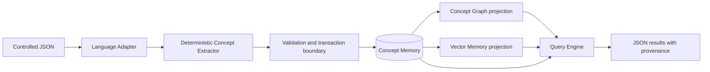

# ECOS CRS Architecture — Working Draft

**Project:** ECOS — Evolutionary Conceptual Operating System  
**Document version:** 0.1.0-draft  
**Status:** Proposed design; not the missing CRS Architecture Specification v0.1 and not implemented  
**Purpose:** Specify the smallest complete Phase 1 architecture for representing and retrieving conceptual knowledge.  
**Last reviewed:** 2026-11-20

## CRS responsibility

The Concept Representation System is the canonical boundary for concepts, claims, evidence, contexts, provenance, assessments, and vector records. It supplies a Concept Graph view, durable Concept Memory, Vector Memory, and a Query Engine. It does not reason, verify, learn autonomously, evolve concepts, or translate unrestricted natural language in the prototype.

## Component flow

## Processing contract

1. The adapter reports source, format, language where relevant, adapter version, and original payload reference.
2. The extractor maps the controlled format to candidate records without inventing missing values.
3. The CRS validates types, references, temporal forms, confidence qualifications, and vector dimensions.
4. One transaction registers IDs and appends the complete batch. Failure leaves the committed store unchanged.
5. Graph and vector views are derived from canonical records and can be rebuilt.
6. Query output includes stored versus derived result kind, provenance references, and any applied filters or bounds.

## Phase 1 interfaces

- `ingest(envelope) -> receipt`: validate and append a batch.
- `get_concept(id) -> Concept`: retrieve identity and labels.
- `find_claims(filter) -> list[Claim]`: exact filters only.
- `neighbors(concept_id, filter) -> list[Claim]`: incident claims with polarity and context.
- `traverse(start_id, max_depth, filter) -> list[Path]`: deterministic bounded traversal.
- `evidence_for(claim_id) -> list[EvidenceRelation]`: retrieve typed evidence and sources.
- `vector_search(query_vector, metric, limit) -> list[VectorMatch]`: search supplied vectors; no embedding generation.
- `export() -> document`: deterministic JSON export for inspection and migration.

These are logical contracts, not an existing Python API.

## Prototype boundaries

- Local, single-writer, small fixtures, structured input, deterministic behavior.
- No server, authentication layer, distributed transaction, unrestricted NLP, or performance claim.
- No automatic contradiction detection: storage must preserve conflicts; reporting every stored conflict is a query concern only.
- No learning or concept lifecycle operations beyond initial creation.
- No neural models, GPU, AtomSpace, RDFLib, graph server, or vector database required.

## Dependency path

The CRS must be stable before Phase 2 reasoning consumes claims and emits derivations. Phase 3 assessments are separate records; Phase 4 learning produces new events; Phase 5 lineage refers to stable concept IDs; Phase 6 frameworks already have a representational home; Phase 7 adapters implement the same exchange contract.

## Build strategy

Start with Python standard-library dataclasses and SQLite. Evaluate AtomSpace through a separate spike only if typed hypergraph queries or rewriting are demonstrated to be necessary. Evaluate RDFLib as an interoperability option rather than forcing the canonical model into triples before the epistemic semantics are stable.

## References

- [Logical data model](logical_data_model.md)
- [Storage architecture](storage_architecture.md)
- [Retrieval architecture](retrieval_architecture.md)
- [Build versus reuse](../05_research/build_vs_reuse.md)
