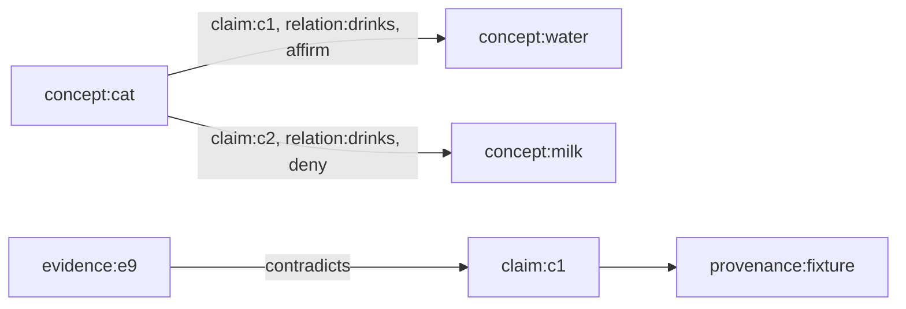

# ECOS Concept Graph Model

**Project:** ECOS — Evolutionary Conceptual Operating System  
**Document version:** 0.1.0-draft  
**Status:** Proposed graph projection; not implemented  
**Purpose:** Define how claims become traversable graph structure without discarding epistemic metadata.  
**Last reviewed:** 2026-11-20

## Graph projection

Concepts are graph vertices. Each claim with a concept object yields a directed relationship from subject concept to object concept through the predicate concept. The claim ID remains attached to that relationship; polarity, context, valid time, and provenance are never stripped.

Claims with literal objects produce value terminals for display but not concept-to-concept paths. Claims about claims form higher-order relations used by assessments and provenance rather than ordinary neighborhood edges.

The drawing is illustrative. The deny relationship is not an assertion that the corresponding affirmative relationship exists.

## Edge identity and multiplicity

There can be many claims for the same `(subject, predicate, object)` tuple. They remain separate because context, polarity, time, source, and assessor can differ. A graph renderer may aggregate them visually, but queries must be able to return each underlying claim.

## Adjacency

- **Outgoing:** claims whose subject is the selected concept.
- **Incoming:** claims whose concept object is the selected concept.
- **Incident:** the union, with direction retained.
- **Filters:** predicate, polarity, context, valid-time interval, provenance, and record status where requested.
- **Default:** return stored claims only; do not infer transitive closure or truth.

## Bounded traversal

A traversal specifies start concept, maximum depth, direction, filters, and result bound. The prototype uses breadth-first enumeration, visited concept IDs, and sorting by claim ID for deterministic output. Cycles terminate through the visited set and depth bound. Returned paths include every claim ID so evidence and provenance can be inspected.

A path is a sequence of stored relationships, not a proof that its composition is true or meaningful. Derived transitive or causal claims require Phase 2 rules and explicit derivation records.

## Contradictory structure

Affirmation and denial can coexist between the same vertices. The graph does not merge them into a single weighted edge. Contradiction detection is a later supervisor function; Phase 1 can only filter and display potentially incompatible stored claims without declaring a verdict.

## Hypergraph comparison

An n-ary event is represented by an event concept and role claims in the minimal model. This avoids requiring hypergraph storage on day one. If higher-order query performance or native term rewriting becomes central, evaluate AtomSpace’s typed hypergraph model through a prototype rather than assuming the event-role encoding is optimal.

## References

- [Logical data model](logical_data_model.md)
- [Retrieval architecture](retrieval_architecture.md)
- [AtomSpace research](../05_research/atomspace_evaluation.md)
