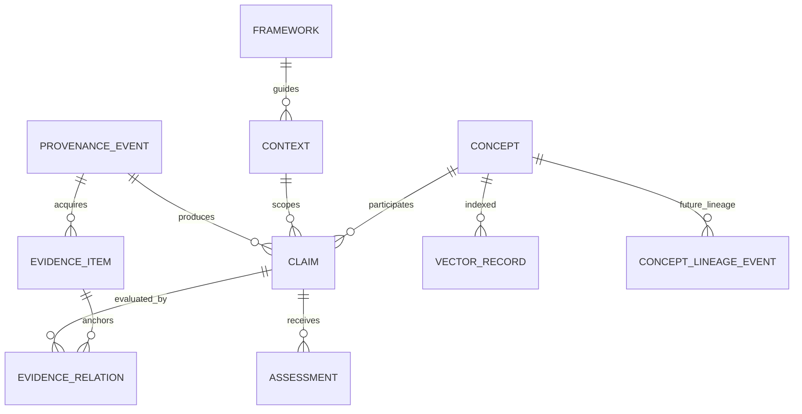

# ECOS CRS Logical Data Model

**Project:** ECOS — Evolutionary Conceptual Operating System  
**Document version:** 0.1.0-draft  
**Status:** Proposed logical model aligned with Ontology Working Draft 0.1.0-draft  
**Purpose:** Define record relationships, identifiers, constraints, and transaction semantics independently of a storage product.  
**Last reviewed:** 2026-11-20

## Entity relationships

This diagram is conceptual. Polymorphic references and relation-type constraints require explicit validation; a diagram alone does not enforce them.

## Identifier registry

Every record ID is registered once with its record type and schema version. References point to this registry, allowing claims and assessments to refer to other claims without losing referential integrity. IDs are opaque; labels and vector values are never used as primary keys.

## Record constraints

| Record | Required relationships and constraints |
|---|---|
| Concept | One kind, schema version, creation time, lifecycle status; zero or more language-tagged labels |
| Claim | One subject, relation predicate, discriminated object, polarity, context, recording time, provenance event |
| Context | Optional framework, assumption claims, and spatial/temporal scope; default context is explicit |
| Framework | Definition and version; formal rule references optional |
| ProvenanceEvent | Activity type, agent and version, source references, times, optional input records |
| EvidenceItem | Source and acquisition event; optional locator, content hash, media type, observed time |
| EvidenceRelation | One evidence item, one claim, relation type (`supports`, `contradicts`, `mentions`), method |
| Assessment | Target, method, assessor, basis, assessment time; optional verdict and fully qualified confidence |
| VectorRecord | One symbolic target, numeric values, dimensions, metric, producer/version, provenance |
| ConceptLineageEvent | Reserved for Phase 5; inputs, outputs, rationale, actor, time, mapping |

## Claim object union

Use an explicit `object_type` of `concept` or `literal`:

- `concept`: `object_ref` resolves to a concept.
- `literal`: `literal_value`, `datatype`, and optional `unit_ref` are stored without silently converting the original lexical value.

Do not store an untyped string that may be either an identifier or text. A null object is invalid; an absent claim about a value is how the model represents lack of knowledge.

## Temporal model

`valid_time` belongs to the claim and can describe an instant or interval with precision/calendar metadata. `recorded_at` is the transaction timestamp. Assessments and provenance events have their own transaction times. No default “now” may be inserted into valid time merely because ingestion time is known.

## Mutation semantics

- Concepts, claims, evidence, and provenance are appended in the prototype.
- Corrections are new claims or assessments linked to the earlier records.
- Indexes and graph adjacency are disposable projections.
- Batch ingest is atomic. Schema and foreign-reference validation occur before commit.
- Schema migrations include source and target versions and must preserve old record IDs.

## Status versus truth

`active` is a record-lifecycle state, not a truth value. `supports` is an evidence relation, not verification. `confidence` is assessor metadata, not a guarantee. Query responses must retain these distinctions.

## References

- [Ontology working draft](../03_ontology/ontology_working_draft.md)
- [Storage architecture](storage_architecture.md)
- [Provenance model](provenance_model.md)
