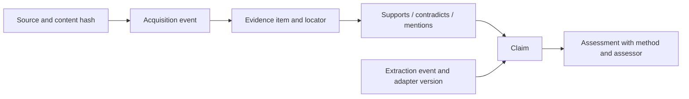

# ECOS Evidence and Provenance Model

**Project:** ECOS — Evolutionary Conceptual Operating System  
**Document version:** 0.1.0-draft  
**Status:** Proposed model; not implemented or validated  
**Purpose:** Make the origin and transformation history of every claim and assessment inspectable.  
**Last reviewed:** 2026-11-20

## Provenance chain

A source is acquired through an event, transformed by an identified adapter/extractor, and used to assert a claim. Evidence relations connect source-backed items to claims. Assessments identify their method and assessor. Every link retains time and agent/version metadata.

## Minimum source metadata

- Source identifier and resolvable locator where available.
- Content hash when bytes or stable text are available.
- Acquisition timestamp and agent.
- Original media type and extraction method where known.
- Fine-grained locator such as page, span, row, or timestamp when available.
- Transformation inputs, agent/version, and activity timestamps.

A missing field remains unknown with a documented reason; it is not replaced with an invented value.

## Standards mapping

W3C PROV-O provides an OWL2 representation for provenance exchange and specialization across systems. ECOS can map its entities, activities, and agents to PROV concepts at an export boundary without adopting OWL as the Phase 1 runtime.[19]

OWL-Time provides vocabulary for instants, intervals, durations, ordering relations, and temporal reference systems. It is a useful mapping target for valid-time export, but ECOS still needs its own rules for partial precision and transaction time.[21]

## Evidence relations

- `supports`: evidence is asserted to increase support for a claim under a stated method.
- `contradicts`: evidence is asserted to conflict with a claim under a stated method.
- `mentions`: evidence refers to the claim’s content without an epistemic judgment.

These relations have their own provenance. They do not automatically change claim confidence or verdict. Evidence quality, independence, and aggregation are Phase 3 research.

## Query requirements

For any claim, a caller can retrieve its assertion event, source chain, evidence items and locators, typed evidence relations, and assessments. For any derived result in later phases, the caller can also retrieve premises and rules. Provenance output identifies missing links rather than presenting a complete-looking chain by default.

## Privacy and integrity

Source locators and raw evidence may contain sensitive data. The local prototype uses public fixtures only. Later services need access control and redaction outside the canonical reasoning layer. Content hashes support integrity checks but do not establish source trustworthiness.

## Open questions

- When is source independence established rather than assumed?
- How are contradictory extraction versions compared?
- What is the lossless RDF/PROV-O mapping for claim polarity and framework context?
- How are redactions represented without breaking provenance chains?

## References

- [Logical data model](logical_data_model.md)
- [Existing research](../05_research/existing_research.md)
- [Open research questions](../05_research/open_research_questions.md)

## Sources

[19] https://www.w3.org/TR/prov-o
[21] https://www.w3.org/TR/owl-time
