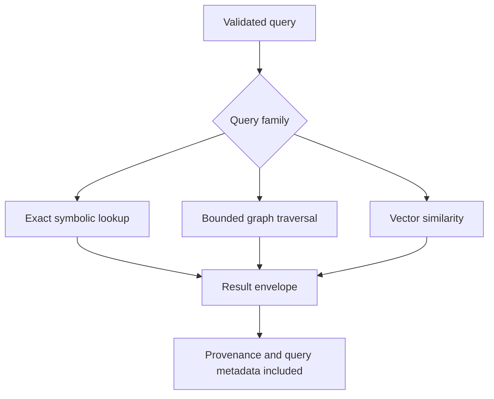

# ECOS CRS Retrieval Architecture

**Project:** ECOS — Evolutionary Conceptual Operating System  
**Document version:** 0.1.0-draft  
**Status:** Proposed retrieval design; not implemented or benchmarked  
**Purpose:** Define deterministic symbolic and vector retrieval without confusing retrieval with reasoning.  
**Last reviewed:** 2026-11-20

## Query families

| Query | Inputs | Output |
|---|---|---|
| Concept lookup | Stable ID | Concept, labels, schema metadata |
| Claim filter | Subject, predicate, object, polarity, context, temporal/provenance filters | Matching immutable claims |
| Neighborhood | Concept, direction, optional filters | Incident claims with direction and full metadata |
| Bounded traversal | Start, depth, direction, filters, result bound | Deterministic paths with claim IDs |
| Evidence lookup | Claim ID | Typed evidence relations, items, locators, provenance |
| Assessment lookup | Target ID | Assessment records and qualification metadata |
| Vector similarity | Numeric vector, metric, limit, optional filters | Scored vector records and symbolic targets |
| Export | Store/schema version | Deterministic, provenance-complete JSON document |

## Execution model

Exact lookups and filters use indexed columns. Graph traversal uses the bounded algorithm in the [graph model](graph_model.md). Vector search compares the supplied query vector against compatible stored vectors using the declared metric and returns a score, never a verdict.

## Result envelope

Every result identifies the query, schema version, result kind (`stored`, `projection`, or later `derived`), filters/bounds, and records. Similarity results additionally include metric, producer/version, and dimensions. An empty result means no matching stored record; it does not mean falsehood.

## Vector rules

- The prototype accepts supplied vectors and does not generate embeddings.
- Dimensions must match; only vectors with compatible producer/model and metric semantics should be compared by default.
- Cosine similarity requires a zero-vector check. Invalid vectors are rejected rather than producing `NaN` scores.
- Results are ordered by score then vector-record ID for deterministic ties.
- Vector scores never overwrite confidence, evidence, or claim polarity.

## Retrieval versus reasoning

Retrieval locates explicit records. Reasoning derives new records through declared rules. A retrieved path is not a proof, and a vector nearest neighbor is not a logical conclusion. Later derived answers must include their derivation and be distinguishable from stored claims.

## Initial performance envelope

The design targets small fixtures and functional correctness, not a latency number. Linear vector scans and SQLite lookups are adequate until measured requirements show otherwise. Benchmarking must publish dataset size, query shape, environment, and revision before any scalability claim.

## References

- [Storage architecture](storage_architecture.md)
- [Prototype requirements](../06_implementation/prototype_requirements.md)
- [Testing strategy](../06_implementation/testing_strategy.md)
